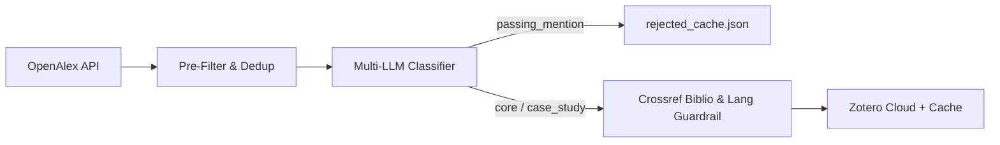

# Assassin's Creed Open Academic Bibliography

English | [简体中文](./README.zh-CN.md)

An open, Zotero-backed scholarly bibliography of **586** curated academic works on *Assassin's Creed* (Game Studies & Digital Humanities), maintained with a reusable OpenAlex + Multi-LLM curation pipeline.

[](https://yiersan-73.github.io/assassins-creed-bibliography/) [](https://www.zotero.org/groups/6777746/assassins_creed_research/library) [](https://www.zotero.org/groups/6777746/assassins_creed_research/library) [](https://www.zotero.org/groups/6777746/assassins_creed_research/library) [](#-automated-curation-pipeline-for-developers) [](./LICENSE)

> [!TIP]
> **Looking for papers or writing a literature review? No login or coding needed!** Search 4D facets and copy citations instantly in the **[Interactive Web Catalog](https://yiersan-73.github.io/assassins-creed-bibliography/)**, or browse all 58 folders & 32 tags directly inside the **[Zotero Public Group (586 Works)](https://www.zotero.org/groups/6777746/assassins_creed_research/library)**.

---

## 📚 Collection Highlights & Coverage

- **Curated Scholarly Scale**: **`586`** verified works (`311` journal articles, `123` theses, `90` book chapters, `36` conference papers, `26` monographs) with **`0`** passing-mention noise.
- **High Currency**: **`32.6%`** (`191` works) were published between **2024 and 2026**, covering recent entries (*Mirage*, *Shadows*) alongside foundational scholarship.
- **Citation & Full-Text Ready**: **`100%`** carry abstracts, publication years, and publisher DOI/URL links, enriched via Crossref with `volume`, `issue`, `pages`, `publisher`, and `editor` fields.

### Top Coverage Snapshot

| Dimension | Highest-Volume Categories | Scale |
| :--- | :--- | :--- |
| **Installments** | `Odyssey` (`117`), `Ezio Trilogy` (`106`), `Origins` (`90`), `Unity` (`84`), `AC1` (`79`) | 12 folders |
| **Research Topics** | `History Memory` (`111`), `Authenticity` (`99`), `Pedagogy` (`92`), `Gender&Race` (`65`) | 19 folders |
| **Languages** | `English` (`347`), `Portuguese` (`64`), `Spanish` (`50`), `French` (`41`), `German` (`17`) | 9 folders |

### What's Inside Every Record

Each entry in Zotero combines standardized citation fields with AI-assisted triage metadata:

| Zotero Field | Included Content | Research Value |
| :--- | :--- | :--- |
| **Citation (`Info`)** | Native `Item Type`, cleaned `Author`/`Editor`, sanitized `Publication`, `Date`, `Volume`, `Issue`, `Pages` | 1-click **APA 7th** / **Chicago** / **GB/T 7714** export |
| **Full-Text Links** | Verified `DOI` + official publisher, OpenAlex, or Semantic Scholar `URL` | Jump directly to the legal source |
| **Full Abstract** | Complete original scholarly abstract (`100%` coverage) | Screen relevance without leaving Zotero |
| **AI Triage (`Extra`)** | `Relevance`, `DocType`, retrieval `Citations`, and a concise **English `AI Summary`** | Skim core findings fast—even for non-English works |
| **4D Index & Tags** | Cross-mounted `Collections` (`58`) + controlled `Tags` (`rel:*`, `type:*`, `game:*`, `lang:*`) | Intersect folder + tags in seconds |

<details>
<summary>Preview a sample Zotero record (Info + Extra AI Summary)</summary>

```yaml
Item Type:  Journal Article
Title:      Translation Techniques Used in Assassin Creed: Renaissance Novel
Authors:    Arbain; Nababan, M.; Santosa, R.; Wiratno, T.
Venue:      Academic Journal of Interdisciplinary Studies, Vol. 11, Issue 3, p. 179 (2022)
DOI / URL:  10.36941/ajis-2022-0076 (direct publisher / Semantic Scholar link)
Extra:
  Relevance:  core
  DocType:    research-article
  Citations:  2
  AI Summary: Concise English summary of the paper's core argument, method, and findings.
Abstract:   Full original scholarly abstract preserved verbatim.
Tags:       Controlled tags (rel:* / type:* / game:* / lang:* / #source/*)
```

</details>

<details>
<summary>Methodology, inclusion criteria & future multi-source roadmap</summary>

- **Current Sources & Maintenance**: Built from **OpenAlex** with **Crossref** bibliographic enrichment and manual quality audits; maintained via ongoing incremental polling (current snapshot: **2026-11**, `586` works).
- **Inclusion & Filtering Criteria**: Requires an abstract (`≥ 120` chars), passes strict academic pre-filtering (excluding guides, trailers, fan novels, 3D assets, and journal/book index pages), and retains only LLM-verified `core` and `case_study` scholarship (`passing_mention` rejected).
- **Known Limitations**: Current indexing relies primarily on OpenAlex, so coverage of regional databases and non-DOI monographs is still partial. The `AI Summary` in `Extra` is meant for rapid triage—always verify claims against the original full text before citing.
- **Planned Multi-Source Expansion**: Future updates plan to integrate additional scholarly platforms—including Chinese databases (**CNKI**, **Wanfang**, **CQVIP**), Japanese academic indexes (**CiNii Research**, **J-STAGE**), Korean/European repositories (**KCI**, **HAL**, **DBLP**), and **Semantic Scholar / Google Scholar** cross-checks—for broader multilingual coverage.

</details>

> [!NOTE]
> **Metadata-Only Compliance**: This public Zotero library shares standardized bibliographic metadata, abstracts, and official publisher DOI/URL links only—no copyrighted PDF full texts are hosted or redistributed.

---

## ⚡ 30-Second Quick Search Guide

Zotero lets you intersect **`1 Folder` + `N Controlled Tags`** for precise, multi-dimensional discovery:

- **1. Choose a Folder Entry**: Click **1** primary topic, discipline, or game folder on the left (e.g., `Topics → Authenticity` or `Games → Unity`).
- **2. Stack Tag Filters**: Multi-select controlled tags at the bottom-left (e.g., `lang:en` + `game:odyssey` + `rel:core`) to narrow results in seconds.
- **3. Separate Peer-Reviewed Literature**: Select `type:research-article`, `type:book`, or `type:book-chapter` while omitting `type:thesis` and `type:book-review` for formal literature reviews.
- **4. Clean Tag View & Instant Export**: Uncheck **Display All Tags in This Library** in Zotero's tag-selector gear menu to hide empty gray tags, then right-click items to copy **APA 7th**, **Chicago**, or **GB/T 7714** references.
- **5. Sync to Local Zotero (Word / LaTeX)**: Multi-select items in the read-only Zotero Web Library, click the **Export** icon to download `.ris` or `.bib` (BibTeX), and import them into your own Zotero Desktop for Word/LaTeX citation plugins.

<details>
<summary>Expand full 4-dimensional taxonomy (58 collections) & 32 controlled tags</summary>

### Four-Dimensional Collection Tree (`taxonomy.json`)

> `58` collections total = `1` root collection + `4` dimension folders + `53` leaf subcollections below.

| Dimension | Count | Included Subcollections |
| :--- | :---: | :--- |
| **Games** | 12 | `AC1`, `Ezio Trilogy`, `AC3`, `Black Flag`, `Unity`, `Syndicate`, `Origins`, `Odyssey`, `Valhalla`, `Mirage`, `Shadows`, `Other games` |
| **Subjects** | 13 | `History`, `Education`, `Games studies`, `Narrative`, `Media&Adaptation Studies`, `Identity`, `Culture`, `Architecture`, `Heritage`, `Tourism&Spatial Studies`, `Religious Studies`, `Linguistics&Localization`, `Other subjects` |
| **Topics** | 19 | `History Memory`, `Authenticity`, `Game-Based Learning & Pedagogy`, `Gender&Race`, `Game mechanism`, `Transmedia Adaptation`, `Player Experience & Affect`, `Power&Ideology`, `Virtual Tourism`, `Mythology & Classical Reception`, `Semiotics & Character Analysis`, `Games Industry`, `Postcolonialism`, `Audio&Music`, `Philosophy & Ontology of Game Worlds`, `Archaeogaming`, `Translation&Localization`, `Game AI, Rendering & Computational Methods`, `Other topics` |
| **Languages** | 9 | `English`, `Portuguese`, `Spanish`, `French`, `German`, `Indonesian`, `Polish`, `Italian`, `Other languages` |

### 32 Controlled Tags (5 Orthogonal Namespaces)

- **`rel:*` (`2`)**: `rel:core`, `rel:case-study`
- **`type:*` (`7`)**: `type:research-article`, `type:thesis`, `type:book-chapter`, `type:conference-paper`, `type:book`, `type:book-review`, `type:other`
- **`game:*` (`12`)**: `game:ac1` through `game:valhalla`, plus `game:other-games`
- **`lang:*` (`9`)**: `lang:en`, `lang:pt`, `lang:es`, `lang:fr`, `lang:de`, `lang:id`, `lang:pl`, `lang:it`, `lang:other`
- **`#source/*` (`2`)**: `#source/openalex`, `#source/auto-retrieved`

</details>

---

## 🛠️ Automated Curation Pipeline (For Developers)

If you only need scholarly references, the Zotero link at the top is all you need—the sections below document the reusable automation codebase for curating your own topic.



- **Config-Driven & Topic-Agnostic**: All search phrases, query matrices, taxonomy mappings, and prompt rules live in `domain_config.json` and `taxonomy.json`.
- **Provider-Agnostic LLM Engine**: Supports OpenAI-compatible endpoints (OpenAI, DeepSeek, Gemini, Qwen, OpenRouter, local Ollama) alongside Anthropic Claude with prompt caching.
- **OpenAlex Free-Plan Incremental Sync**: `openalex_incremental.py` combines `from_publication_date` + 30-day safety overlap (`publication`) and 4-call `full-diff` modes.
- **Sustainable Catalog Auto-Sync**: `export_catalog.py` (`python export_catalog.py --group-id 6777746 --skip-if-unchanged`) & `.github/workflows/sync-catalog.yml` export sanitized CC0/CC BY snapshots (`data/`, `docs/data/catalog.json`) weekly with zero API secrets.

### Project Structure

| File | Role | Edit for New Topic? |
| :--- | :--- | :---: |
| `openalextest.py` | Shared core engine (OpenAlex, pre-filter, Multi-LLM, Crossref, Zotero) | No |
| `openalex_sweep.py` | Stage-1 full-pool sweep CLI (`--dry-run`, `--limit`, `--chunk-size`) | No |
| `openalex_incremental.py` | Free-Plan incremental monitor (`publication` & `full-diff` modes) | No |
| `export_catalog.py` | Public Zotero group exporter (`data/` CSV/JSON + web `catalog.json`) | Pass `--group-id` |
| `docs/index.html` | Zero-dependency GitHub Pages 4D interactive web catalog | No |
| `data/` | CC0/CC BY sanitized `bibliography.csv`, `bibliography.json`, & data card | Auto-generated |
| `domain_config.json` | Search phrases, query matrix, tag rules, & domain filters | Yes |
| `taxonomy.json` | Zotero 8-character Collection Keys across custom dimensions | Yes |
| `CITATION.cff` | Standard GitHub citation metadata (`Cite this repository`) | Yes |
| `.github/workflows/sync-catalog.yml` | Weekly zero-secret GitHub Actions Zotero-to-Pages sync | Update `--group-id` |
| `.env.example` | Credential & Multi-LLM configuration template | Copy to `.env` |
| `requirements.txt` | Minimal dependencies (`pyzotero`, `requests`, `python-dotenv`) | No |

---

## 🚀 Quick Start & Multi-LLM Setup

> [!IMPORTANT]
> Requires **Python 3.9+**, a **Zotero API key**, and any **OpenAI-compatible or Anthropic LLM endpoint**. With `LLM_PROVIDER=openai`, the optional `anthropic` package is not required.

```bash
git clone https://github.com/yiersan-73/assassins-creed-bibliography.git
cd assassins-creed-bibliography
python -m venv .venv
# Activate venv: source .venv/bin/activate (macOS/Linux) or .venv\Scripts\Activate.ps1 (Windows)
pip install -r requirements.txt
cp .env.example .env
# Edit .env with your LLM endpoint/key, Zotero credentials, and ZOTERO_ROOT_COLLECTION_KEY

python openalex_sweep.py --dry-run
python openalex_incremental.py --days 30 --dry-run
```

<details>
<summary>Expand latest Multi-LLM provider presets (.env examples) & core variables</summary>

### Core `.env` Variables

| Variable | Purpose | Placeholder |
| :--- | :--- | :--- |
| `LLM_PROVIDER` | Protocol selector (`openai` or `anthropic`) | `openai` |
| `LLM_API_KEY` | API key for your selected LLM provider | `your_llm_api_key_here` |
| `LLM_BASE_URL` | Base URL for OpenAI-compatible or custom endpoints | `https://api.openai.com/v1` |
| `LLM_MODEL` | Model identifier used for classification | `gpt-5.4-mini` |
| `ZOTERO_USER_ID` | Zotero numeric user ID or group ID | `your_zotero_user_or_group_id_here` |
| `ZOTERO_LIBRARY_TYPE` | Library scope (`user` or `group`) | `user` |
| `ZOTERO_API_KEY` | Zotero API key with library write permission | `your_zotero_api_key_here` |
| `ZOTERO_ROOT_COLLECTION_KEY` | Target root folder 8-char key (from Zotero web URL `.../collections/<KEY>`) | `your_root_collection_key_here` |
| `OPENALEX_API_KEY` | Optional OpenAlex API key for dedicated daily quota | `your_openalex_api_key_here` |
| `USER_EMAIL` | Contact email sent in polite API `User-Agent` headers | `your_email@example.com` |

### Latest Verified Provider Presets

```ini
# 1. OpenAI (use gpt-5.4-nano for ultra-low-cost classification)
LLM_PROVIDER=openai
LLM_API_KEY=your_llm_api_key_here
LLM_BASE_URL=https://api.openai.com/v1
LLM_MODEL=gpt-5.4-mini

# 2. DeepSeek
LLM_PROVIDER=openai
LLM_API_KEY=your_llm_api_key_here
LLM_BASE_URL=https://api.deepseek.com/v1
LLM_MODEL=deepseek-flash

# 3. Google Gemini (OpenAI-Compatible Endpoint; or gemini-3.1-flash-lite)
LLM_PROVIDER=openai
LLM_API_KEY=your_llm_api_key_here
LLM_BASE_URL=https://generativelanguage.googleapis.com/v1beta/openai
LLM_MODEL=gemini-3-flash

# 4. Local Free Ollama (qwen3:8b or qwen3:14b)
LLM_PROVIDER=openai
LLM_API_KEY=ollama
LLM_BASE_URL=http://localhost:11434/v1
LLM_MODEL=qwen3:14b

# 5. Anthropic Claude (requires optional: pip install anthropic)
LLM_PROVIDER=anthropic
LLM_API_KEY=your_llm_api_key_here
LLM_BASE_URL=
LLM_MODEL=claude-haiku-5-5
```

</details>

<details>
<summary>Expand minimal domain_config.json example for reusing on another research topic</summary>

```json
{
  "topic_name": "Digital Dunhuang",
  "topic_domain": "Digital Humanities & Dunhuang Mogao Caves studies",
  "search_phrases": ["digital dunhuang", "mogao caves"],
  "entities": ["Digital Dunhuang", "Mogao Caves"],
  "perspectives": ["photogrammetry", "cultural heritage", "virtual conservation"],
  "taxonomy_defaults": {
    "Periods": "General",
    "Themes": "Other themes",
    "Languages": "English"
  },
  "tag_dimensions": {
    "Periods": { "prefix": "period" },
    "Languages": { "prefix": "lang", "aliases": { "English": "en" } }
  }
}
```

</details>

> [!WARNING]
> **Never commit `.env` or local state JSON files** (`zotero_cache.json`, `rejected_cache.json`, `batch_history.json`). Enable GitHub **Secret scanning** and **Push protection** before publishing any fork.

---

## 🤝 Contributing, Citation & Acknowledgments

- **Suggest Missing Papers or Corrections**: The Zotero group is read-only (`Public, Closed Membership`) to preserve curation quality. Found a missing paper (including Chinese, Japanese, or regional studies) or a metadata typo? Open a **[GitHub Issue](https://github.com/yiersan-73/assassins-creed-bibliography/issues)** with the title, DOI/URL, and suggested category—Pull Requests for pipeline/config enhancements are also welcome.
- **Acknowledgments**: Built upon open scholarly metadata infrastructure provided by **OpenAlex**, **Crossref**, and **Zotero**.

<details>
<summary>How to cite this bibliography (APA & BibTeX)</summary>

**Plain Text (APA 7th):**

> yiersan-73. (2026). *Assassin's Creed Open Academic Bibliography* [Dataset & software]. GitHub & Zotero. https://github.com/yiersan-73/assassins-creed-bibliography

```bibtex
@misc{yiersan73_2026_ac_bibliography,
  author       = {yiersan-73},
  title        = {Assassin's Creed Open Academic Bibliography},
  year         = {2026},
  howpublished = {Zotero Public Group \& GitHub},
  url          = {https://github.com/yiersan-73/assassins-creed-bibliography},
  note         = {Public Zotero Library: https://www.zotero.org/groups/6777746/assassins_creed_research/library}
}
```

</details>

---

## 📄 License

- **Bibliographic Metadata**: Curated Zotero metadata is openly shared under **CC BY 4.0 / CC0** for academic research and citation indexing.
- **Source Code & Templates**: Released under the [MIT License](./LICENSE).
