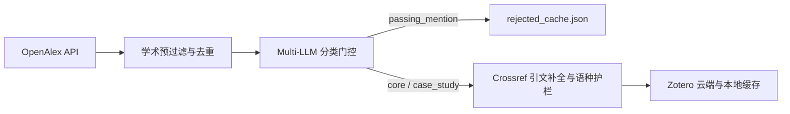

# 《刺客信条》开放学术文献库

[English](./README.md) | 简体中文

面向游戏研究（Game Studies）与数字人文（Digital Humanities）的 **《刺客信条》开放 Zotero 学术文献库（`586` 篇）**，配套配置驱动的 OpenAlex + Multi-LLM 自动策展工具。

[](https://www.zotero.org/groups/6777746/assassins_creed_research/library) [](https://www.zotero.org/groups/6777746/assassins_creed_research/library) [](https://www.zotero.org/groups/6777746/assassins_creed_research/library) [](#-%E8%87%AA%E5%8A%A8%E5%8C%96%E7%AD%96%E5%B1%95%E5%BC%95%E6%93%8E%E9%9D%A2%E5%90%91%E5%BC%80%E5%8F%91%E8%80%85%E4%B8%8E%E5%A4%8D%E7%94%A8%E8%80%85) [](./LICENSE)

> [!TIP]
> **需要找论文、写课程论文或毕业论文文献综述？无需注册账号、无需懂代码！** 直接点击进入 **[Zotero 公开文献库（586 篇）](https://www.zotero.org/groups/6777746/assassins_creed_research/library)**，即可按 58 个四维目录与 32 个标签筛选文献并一键导出 APA / GB/T 7714 引文。

---

## 📚 文献库收录概览

- **学术体量与纯度**：共收录 **`586`** 篇严格去重清洗的文献（期刊论文 `311`、学位论文 `123`、书章节 `90`、会议论文 `36`、专著 `26`），**`0`** 篇擦边文残留（已自动拦截全部 `passing-mention`）。
- **高前沿时效性**：**`32.6%`**（`191` 篇）发表于 **2024–2026 年**，兼顾 *Mirage* / *Shadows* 前沿动态与经典奠基文献。
- **引文与全文即用**：**`100%`** 附带摘要、年份与 DOI/URL 直达链接，并已通过 Crossref 补齐期刊卷/期/页码与书章节出版社、主编字段。

### 热门维度覆盖速览

| 维度 | 高频代表分类（篇数） | 目录规模 |
| :--- | :--- | :--- |
| **游戏作品** | `Odyssey` (`117`)、`Ezio Trilogy` (`106`)、`Origins` (`90`)、`Unity` (`84`)、`AC1` (`79`) | 12 个子类 |
| **核心议题** | `History Memory` (`111`)、`Authenticity` (`99`)、`Pedagogy` (`92`)、`Gender&Race` (`65`) | 19 个子类 |
| **学术语种** | `English` (`347`)、`Portuguese` (`64`)、`Spanish` (`50`)、`French` (`41`)、`German` (`17`) | 9 个语种 |

### 每篇文献包含哪些字段

每条 Zotero 题录都同时提供标准引文字段与 AI 速读辅助信息，点开任意条目即可查看：

| Zotero 字段位置 | 收录内容 | 对检索与写作的帮助 |
| :--- | :--- | :--- |
| **基础题录（`Info`）** | 原生文献类型（期刊/书章节/学位论文等）、规范化作者/主编、清洗后刊名/出版社、年份、卷/期/页码 | 一键导出合规的 **APA 7th** / **Chicago** / **GB/T 7714** 引文 |
| **全文直达（`DOI` / `URL`）** | 核验后的 `DOI` 与出版商、OpenAlex 或 Semantic Scholar 原文落地页链接 | 一键跳转合法获取全文 |
| **完整摘要（`Abstract`）** | 保留完整原始学术摘要（`100%` 覆盖） | 无需离开 Zotero 即可判断是否切题 |
| **AI 速读卡片（`Extra`）** | 结构化标注 `Relevance`（核心/案例）、`DocType`、入库时 `Citations` 及精炼的 **英文 `AI Summary`** | 几秒速览核心论点，看葡/西/法/印尼语等非英语文献也无障碍 |
| **多维归档与标签（`Tags`）** | 跨四维挂载于 `58` 个目录，并附带 `rel:*`、`type:*`、`game:*`、`lang:*` 受控标签 | 左侧选目录 + 左下角叠标签，秒级锁定精准文献池 |

<details>
<summary>点击展开查看单条 Zotero 文献完整字段示例</summary>

```yaml
Item Type:  Journal Article
Title:      Translation Techniques Used in Assassin Creed: Renaissance Novel
Authors:    Arbain; Nababan, M.; Santosa, R.; Wiratno, T.
Venue:      Academic Journal of Interdisciplinary Studies, Vol. 11, Issue 3, p. 179 (2022)
DOI / URL:  10.36941/ajis-2022-0076 (direct publisher / Semantic Scholar link)
Extra:
  Relevance:  core
  DocType:    research-article
  Citations:  2
  AI Summary: Concise English summary of the paper's core argument, method, and findings.
Abstract:   Full original scholarly abstract preserved verbatim.
Tags:       Controlled tags (rel:* / type:* / game:* / lang:* / #source/*)
```

</details>

<details>
<summary>点击展开查看收录方法论、学术边界与未来多平台扩展计划</summary>

- **当前数据源与更新节奏**：以 **OpenAlex** 为主数据源，结合 **Crossref** 引文补全与人工质量审计构建；持续通过增量巡检更新（当前快照截至 **2026-11**，共 `586` 篇）。
- **收录与过滤标准**：要求具备完整摘要（`≥ 120` 字符），通过严格学术预过滤（剔除游戏攻略、预告片、官方同人小说、3D 模型资产及期刊/图书目录页），仅保留经 LLM 判定的核心专论（`core`）与实质性案例研究（`case_study`），拦截全部擦边文（`passing_mention`）。
- **已知学术边界**：现阶段主要依赖 OpenAlex 索引，对区域性数据库与无 DOI 专著的覆盖尚不完全；`Extra` 中的 `AI Summary` 仅供快速初筛，正式论文引用前请务必核对原文全文。
- **未来多平台扩展计划**：后续计划逐步对接更多国际与区域学术平台——包括中文学术库（如 **知网 CNKI**、**万方**、**维普**）、日文学术索引（如 **CiNii Research**、**J-STAGE**）、韩文与欧洲知识库（如 **KCI**、**HAL**、**DBLP**）以及 **Semantic Scholar / Google Scholar** 交叉补漏，持续拓宽多语种覆盖面。

</details>

> [!NOTE]
> **版权合规说明**：公开 Zotero 群组仅分享规范化后的书目题录、摘要与出版商合法 DOI/URL 链接，不托管、不传播任何受版权保护的 PDF 全文。

---

## ⚡ 30 秒上手检索指南

Zotero 客户端与网页版均支持 **「左侧单选 1 个文件夹」 + 「左下角多选 N 个标签」** 的组合交集检索：

- **1. 选定主入口文件夹**：在左侧目录树点击 **1** 个主题、学科或作品（如 `Topics → Authenticity` 或 `Games → Unity`）。
- **2. 叠加多维控制标签**：在左下角标签栏连续点选标签（如 `lang:en` + `game:odyssey` + `rel:core`），秒级缩小到精准核心池。
- **3. 剥离同行评审文献**：撰写正式文献综述时，叠加勾选 `type:research-article`、`type:book`、`type:book-chapter`（按需排除 `type:thesis` 与 `type:book-review`）。
- **4. 清爽标签栏与一键导出**：在 Zotero 标签栏齿轮图标取消勾选 **显示此文库中的所有标签**，选中文献右键即可直接导出 **APA 7th**、**Chicago** 或 **GB/T 7714** 引文。
- **5. 导入本地 Zotero 配合 Word / LaTeX 写作**：在只读网页库中勾选所需文献，点击顶部导出图标下载 `.ris` 或 `.bib`（BibTeX），拖入自己的 Zotero 桌面端即可联动 Word / LaTeX 插件自动插引文。

<details>
<summary>点击展开查看完整四维分类体系（58 个集合）与 32 个受控标签清单</summary>

### 四维分类目录树（`taxonomy.json`）

> 总计 `58` 个集合 = `1` 个根集合 + `4` 个维度目录 + 下表 `53` 个叶子子类。

| 维度 | 数量 | 包含子类 |
| :--- | :---: | :--- |
| **Games** | 12 | `AC1`、`Ezio Trilogy`、`AC3`、`Black Flag`、`Unity`、`Syndicate`、`Origins`、`Odyssey`、`Valhalla`、`Mirage`、`Shadows`、`Other games` |
| **Subjects** | 13 | `History`、`Education`、`Games studies`、`Narrative`、`Media&Adaptation Studies`、`Identity`、`Culture`、`Architecture`、`Heritage`、`Tourism&Spatial Studies`、`Religious Studies`、`Linguistics&Localization`、`Other subjects` |
| **Topics** | 19 | `History Memory`、`Authenticity`、`Game-Based Learning & Pedagogy`、`Gender&Race`、`Game mechanism`、`Transmedia Adaptation`、`Player Experience & Affect`、`Power&Ideology`、`Virtual Tourism`、`Mythology & Classical Reception`、`Semiotics & Character Analysis`、`Games Industry`、`Postcolonialism`、`Audio&Music`、`Philosophy & Ontology of Game Worlds`、`Archaeogaming`、`Translation&Localization`、`Game AI, Rendering & Computational Methods`、`Other topics` |
| **Languages** | 9 | `English`、`Portuguese`、`Spanish`、`French`、`German`、`Indonesian`、`Polish`、`Italian`、`Other languages` |

### 32 个受控标签（5 组正交命名空间）

- **`rel:*`（`2`）**：`rel:core`（核心专论）、`rel:case-study`（实质性案例研究）
- **`type:*`（`7`）**：`type:research-article`、`type:thesis`、`type:book-chapter`、`type:conference-paper`、`type:book`、`type:book-review`、`type:other`
- **`game:*`（`12`）**：`game:ac1` 至 `game:valhalla`，以及 `game:other-games`
- **`lang:*`（`9`）**：`lang:en`、`lang:pt`、`lang:es`、`lang:fr`、`lang:de`、`lang:id`、`lang:pl`、`lang:it`、`lang:other`
- **`#source/*`（`2`）**：`#source/openalex`、`#source/auto-retrieved`

</details>

---

## 🛠️ 自动化策展引擎（面向开发者与复用者）

如果你只为查阅论文而来，点开顶部的 Zotero 文献库链接就已经够用了；以下内容供希望复用这套流水线、搭建其他学科文献库的开发者参考。



- **配置与题材彻底解耦**：检索短语、词库矩阵、分类树与 Prompt 规则全部外置在 `domain_config.json` 与 `taxonomy.json`，换研究题材无需改代码。
- **全大模型通用适配**：一套接口兼容 OpenAI 协议（OpenAI、DeepSeek、Gemini、通义千问、OpenRouter、本地 Ollama）与 Anthropic Claude（保留 Prompt Caching 加速）。
- **OpenAlex 免费档增量巡检**：`openalex_incremental.py` 通过 `from_publication_date` + 30 天安全重叠窗口与 4 次全池差量回溯实现长期自动更新。

### 项目结构

| 文件名 | 核心职责 | 换主题需修改? |
| :--- | :--- | :---: |
| `openalextest.py` | 共享核心引擎（OpenAlex、学术过滤、Multi-LLM、Crossref、Zotero） | 无需修改 |
| `openalex_sweep.py` | Stage-1 全库直扫脚本（支持 `--dry-run` / `--limit` / `--chunk-size`） | 无需修改 |
| `openalex_incremental.py` | OpenAlex 免费档增量巡检脚本（`publication` 与 `full-diff` 模式） | 无需修改 |
| `domain_config.json` | 领域配置文件（检索短语、矩阵词库、标签规则与过滤项） | 需定制 |
| `taxonomy.json` | Zotero 8 位 Collection Key 分类映射字典 | 需定制 |
| `.env.example` | 环境变量与大模型配置模板（复制为 `.env` 后使用） | 复制并填写 |
| `requirements.txt` | 极简依赖清单（仅需 `pyzotero`、`requests`、`python-dotenv`） | 无需修改 |

---

## 🚀 快速部署与多模型配置

> [!IMPORTANT]
> 运行环境需 **Python 3.9+**、**Zotero API Key**，以及任意 **OpenAI 兼容或 Anthropic 模型接口**。使用 OpenAI 兼容协议（`LLM_PROVIDER=openai`）时无需安装 `anthropic` 包。

```bash
git clone https://github.com/yiersan-73/assassins-creed-bibliography.git
cd assassins-creed-bibliography
python -m venv .venv
# 激活虚拟环境：source .venv/bin/activate（macOS/Linux）或 .venv\Scripts\Activate.ps1（Windows）
pip install -r requirements.txt
cp .env.example .env
# 编辑 .env，填入大模型接口/密钥、Zotero 账号与 ZOTERO_ROOT_COLLECTION_KEY

python openalex_sweep.py --dry-run
python openalex_incremental.py --days 30 --dry-run
```

<details>
<summary>点击展开查看最新各大模型平台 .env 配置预设与核心环境变量表</summary>

### 核心环境变量（`.env`）

| 变量名 | 说明 | 占位示例 |
| :--- | :--- | :--- |
| `LLM_PROVIDER` | 接口协议类型（`openai` 或 `anthropic`） | `openai` |
| `LLM_API_KEY` | 所选大模型服务商的 API 密钥 | `your_llm_api_key_here` |
| `LLM_BASE_URL` | OpenAI 兼容端点或自定义反代地址 | `https://api.openai.com/v1` |
| `LLM_MODEL` | 用于分类与摘要提取的模型标识 | `gpt-5.4-mini` |
| `ZOTERO_USER_ID` | Zotero 数字用户 ID 或群组 ID | `your_zotero_user_or_group_id_here` |
| `ZOTERO_LIBRARY_TYPE` | 目标文库类型（`user` 或 `group`） | `user` |
| `ZOTERO_API_KEY` | 具备写入权限的 Zotero API Key | `your_zotero_api_key_here` |
| `ZOTERO_ROOT_COLLECTION_KEY` | 根集合 8 位 Key（在 Zotero 网页 URL `.../collections/<KEY>` 中查看） | `your_root_collection_key_here` |
| `OPENALEX_API_KEY` | 可选 OpenAlex API Key（启用独立每日额度） | `your_openalex_api_key_here` |
| `USER_EMAIL` | 用于规范 API 请求头 `User-Agent` 的联系邮箱 | `your_email@example.com` |

### 最新官方推荐模型配置预设

```ini
# 1. OpenAI（极低成本批量分类可选 gpt-5.4-nano）
LLM_PROVIDER=openai
LLM_API_KEY=your_llm_api_key_here
LLM_BASE_URL=https://api.openai.com/v1
LLM_MODEL=gpt-5.4-mini

# 2. DeepSeek
LLM_PROVIDER=openai
LLM_API_KEY=your_llm_api_key_here
LLM_BASE_URL=https://api.deepseek.com/v1
LLM_MODEL=deepseek-flash

# 3. Google Gemini（OpenAI 兼容端点；极速轻量可选 gemini-3.1-flash-lite）
LLM_PROVIDER=openai
LLM_API_KEY=your_llm_api_key_here
LLM_BASE_URL=https://generativelanguage.googleapis.com/v1beta/openai
LLM_MODEL=gemini-3-flash

# 4. 本地免费 Ollama（可选 qwen3:8b 或 qwen3:14b）
LLM_PROVIDER=openai
LLM_API_KEY=ollama
LLM_BASE_URL=http://localhost:11434/v1
LLM_MODEL=qwen3:14b

# 5. Anthropic Claude（需额外安装：pip install anthropic）
LLM_PROVIDER=anthropic
LLM_API_KEY=your_llm_api_key_here
LLM_BASE_URL=
LLM_MODEL=claude-haiku-5-5
```

</details>

<details>
<summary>点击展开查看跨题材复用 domain_config.json 示例（如 Digital Dunhuang）</summary>

```json
{
  "topic_name": "Digital Dunhuang",
  "topic_domain": "Digital Humanities & Dunhuang Mogao Caves studies",
  "search_phrases": ["digital dunhuang", "mogao caves"],
  "entities": ["Digital Dunhuang", "Mogao Caves"],
  "perspectives": ["photogrammetry", "cultural heritage", "virtual conservation"],
  "taxonomy_defaults": {
    "Periods": "General",
    "Themes": "Other themes",
    "Languages": "English"
  },
  "tag_dimensions": {
    "Periods": { "prefix": "period" },
    "Languages": { "prefix": "lang", "aliases": { "English": "en" } }
  }
}
```

</details>

> [!WARNING]
> **严禁提交 `.env` 或本地缓存 JSON**（`zotero_cache.json`、`rejected_cache.json`、`batch_history.json`）。推上 GitHub 前务必在仓库 `Settings → Code security` 开启 **Secret scanning** 与 **Push protection**。

---

## 🤝 参与贡献、引用与致谢

- **补充遗漏论文或纠错反馈**：为保障分类质量，公开 Zotero 群组保持只读（`Public, Closed Membership`）。若发现漏收文献（包括中文、日文及其他语种研究）或题录/分类有误，欢迎提交 **[GitHub Issue](https://github.com/yiersan-73/assassins-creed-bibliography/issues)**（附标题、DOI/链接及建议分类），也欢迎提交代码或配置 PR。
- **致谢**：感谢 **OpenAlex**、**Crossref** 与 **Zotero** 提供的开放学术元数据与文献管理基础设施。

<details>
<summary>点击展开查看本文献库引用格式（APA & BibTeX）</summary>

**APA 7th 文本引用：**

> yiersan-73. (2026). *Assassin's Creed Open Academic Bibliography* [Dataset & software]. GitHub & Zotero. https://github.com/yiersan-73/assassins-creed-bibliography

```bibtex
@misc{yiersan73_2026_ac_bibliography,
  author       = {yiersan-73},
  title        = {Assassin's Creed Open Academic Bibliography},
  year         = {2026},
  howpublished = {Zotero Public Group \& GitHub},
  url          = {https://github.com/yiersan-73/assassins-creed-bibliography},
  note         = {Public Zotero Library: https://www.zotero.org/groups/6777746/assassins_creed_research/library}
}
```

</details>

---

## 📄 开源协议

- **策展书目元数据**：公开 Zotero 文献元数据采用 **CC BY 4.0 / CC0** 开放共享，仅供学术检索与引用。
- **源代码与配置模板**：遵循 [MIT License](./LICENSE) 开源许可。
